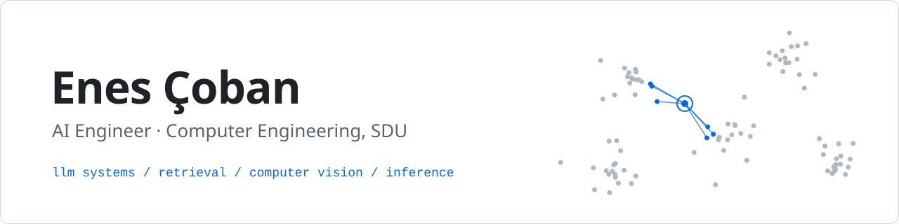

<picture>
  <source media="(prefers-color-scheme: dark)" srcset="assets/banner-dark.svg">
  
</picture>

 

AI engineer and final-year Computer Engineering student at Süleyman Demirel University. I work on LLM systems, information retrieval and computer vision, with a focus on models and services that run efficiently on local and resource-constrained hardware.

### Areas of work

<table>
  <tr><td><b>LLM systems</b></td><td>Retrieval-augmented generation, agentic pipelines, structured generation</td></tr>
  <tr><td><b>Model adaptation</b></td><td>Fine-tuning open-weight models (full, LoRA, QLoRA), quantization and GGUF conversion, local serving</td></tr>
  <tr><td><b>Search and recommendation</b></td><td>Hybrid lexical and vector search, embedding models, ranking, preference modelling</td></tr>
  <tr><td><b>Computer vision</b></td><td>Object detection and tracking, small-object detection on aerial imagery, TensorRT and CUDA optimisation</td></tr>
  <tr><td><b>Speech</b></td><td>Streaming speech recognition and synthesis, real-time turn-taking for voice assistants</td></tr>
  <tr><td><b>Backend</b></td><td>API design, data pipelines, relational and vector databases, containerised deployment</td></tr>
</table>

### Stack

<table>
  <tr><td><b>Languages</b></td><td>Python, Java, C#, Go, SQL, C/C++</td></tr>
  <tr><td><b>ML and AI</b></td><td>PyTorch, Hugging Face, Sentence Transformers, LangChain, Ollama, OpenCV, YOLO, TensorRT, scikit-learn</td></tr>
  <tr><td><b>Backend</b></td><td>Spring Boot, Spring AI, FastAPI, PostgreSQL, pgvector, Qdrant, SQLite</td></tr>
  <tr><td><b>Tooling</b></td><td>Docker, Git, Linux, AWS, MLflow</td></tr>
</table>

### Contact

[LinkedIn](https://linkedin.com/in/enescobann)
